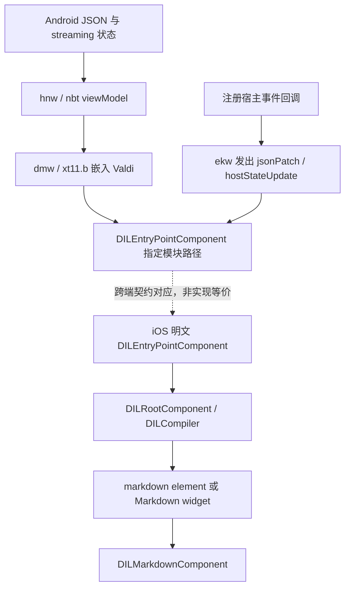

# 293 消息链追踪：宿主桥接、流式生命周期与剩余断点

2026-11-03 后续批次。目标仍为本地 Android/iOS 1.2026.293 制品，不启动目标 App、不访问线上服务。以下区分包内静态观察、隔离回放和未知；不是端到端行为验收。

## 本轮结论

已确认 Android 有具体 DIL 原生宿主，能把 JSON 和流式状态交给 Valdi 根组件，并通过注册回调发送 JSON patch/host state。iOS 明文能继续追到 DIL 编译与 Markdown 渲染，但对应 Android 文件仍是字节码，跨端仅能建立契约对应，不能直接借用 iOS 实现证明 Android 行为。

`ChatGPTStreamingWorkerClient` 服务内部链仍未找到主聊天消费者。另有 Android 原生 Compose 的 Markdown/reasoning 分支。因此不能把“worker 生成 markdownBlocks”和“DIL 组件接受 parsedBlocks”直接拼成完整主聊天链。

最重要的纠正：`ConversationStreamingService` 是任务保活/超时停止辅助服务，不是消息渲染桥。上一轮将它作为原生定位入口是线索，不能提升为内容链证据。

## 证据与复现

- [38 个文件/字节/行锚点、7 项有界搜索、跨端候选摘要](../analysis/message-followup-20261103/message-evidence.json)：下文 V/D/N/S 编号均对应该清单，保留 SHA-256 与实际片段。
- [12 项隔离回放](../analysis/message-followup-20261103/controlled-replay.json)：执行特定包内 JS 类，假时钟、假 worker endpoint、Markdown 解析桩；无原生桥接或网络。
- [REA 五文件静态分析摘要](../analysis/message-followup-20261103/rea-services-summary.json)及[完整证据包](../analysis/message-followup-20261103/rea-services-bundle.json)。父 Evidence `ev_cdcb3949c4b205a99efe97c7404d58be534d4c7fad310e7ff063d32b7bceed7f`，REA 6.8.0；5 个选定文件解析成功，14 个文件未选入，语义图 partial。图中的动态关系/未知项没有被视为不存在。

```sh
# 输出路径必须是新的；不会覆盖此前证据
python3 -B analysis/tools/build_message_evidence.py --output /tmp/message-evidence-new.json
# shell 在沙箱外接收 stdout；目标片段所在进程禁止网络、文件写入及 fork
sandbox-exec -f analysis/tools/message-replay.sb node analysis/tools/replay_message_pipeline.cjs
python3 -B -m unittest discover -s analysis/tests -v
```

## 1. Android：分清保活服务与真实内容处理

`ConversationStreamingService.onBind` 返回 null；`onStartCommand` 重置 1,200,000ms 定时器，超时由 `gl1` 调用 `stopSelf()`。类中没有消息正文处理或 renderer（N01/N02）。这只证明代码职责，不证明设备上一定如何调度后台任务。

原生协调器的候选入口是 `zaq.A0`，创建 `d8q` 协程并注册完成回调；`d8q` 条件启动保活 Service，`itb` 做完成清理并停止 Service（N03，另见 `d8q.java:360`、`itb.java:86`）。`c8q.emit` 是流事件处理候选，但 JADX 明示 `Code decompiled incorrectly`（N13）。因此本轮不从它推导完整增量、终止和失败状态机。

## 2. Android：已找到的 DIL 宿主边界



原生组件精确指定 `DILEntryPointComponent@dil_widgets/src/DILEntryPointComponent`（N04）。`nbt` schema 包含 `dilJson/dilJsonObject/messageIsStreaming`，`hnw` 从 JSON 和 boolean 创建 viewModel（N05/N06）。`lbt` context 包含 `registerOnEventHandler/hostStateEventsReady`（N07）；`dmw.java:784–791` 注入注册/acknowledge callbacks，`:842` 嵌入 Valdi。嵌入及 acknowledge 另以较小 smali 方法交叉核对（S03/S04）。

`ekw` 构造 `DILEventJSONPatch` 和 `DILHostStateUpdate`，通过已注册 `Function1` 发送 `obt` 事件；构造调用也见 smali（N08/S01/S02）。这证明原生事件契约和发送点，不证明每种 patch 在实际 UI 中都已验收。

上层已追到 `a63.r → hmw/jid0.c → dmw.b`（N09/N14）。尚未证明主聊天内容模型在何种分支调用该入口，也未闭合 `zaq` 流状态到该内容模型的映射。

**不能采信的细节**：`cmw` 的 full-replace/patch/fallback 选择方法含 JADX 错误标记和可疑表达式（N10）；`dmw` 大方法也有大量警告。当前只采纳已被小方法或 smali 支撑的桥接事实，不把反编译复杂分支当作正确状态机。

## 3. iOS 明文：DIL 到 Markdown 的具体链路

- **入口与状态**：`DILEntryPointComponent.renderDILRootComponent` 转交 `dilJson/dilJsonObject/messageIsStreaming`，context 注入 element/widget registries。宿主事件更新 streaming 状态并转发内容事件（D01–D03）。
- **数据更新与编译**：`DILRootComponent` 在输入变化时重编译；JSON patch 路径调用 `compiler.incrementalCompile`（D04）。这与上节 Android event schema 契合，但两端 JS 字节并不相同。
- **渲染**：小写 `markdown` element 经 `DILMarkdownElementRenderer`；大写 `Markdown` widget 经 `MarkdownWidgetRendererFactory`。两条路径都传 `markdown` 文本（D05–D07），没有传 worker 的 `markdownBlocks`。`DILMarkdownComponent` 支持调用者提供 `parsedBlocks`，否则自行 parse/parseRich（D08）；能力存在不等于本链用到了预解析 blocks。
- **交互副作用**：选择菜单向宿主 `textSelectionMenuActionHandler` 转交 id/选中文本；组件支持可选 `onOpenLink`，但本轮两条 registry 路径没有证实注入该回调，不能判定原生链接已可点击（D09–D11）。最终系统剪贴板、打开链接和菜单体验均未运行验证。

`DILMarkdownElementRenderer` 明确忽略 element 自身的 `streaming` prop；widget 路径传入 render-state 的 streamingAnimation。不能仅据这个 prop 名称解释所有光标/动画。其具体呈现仍需对应层状态或受控渲染证据。

## 4. Valdi 服务链：生命周期得到回放验证，主宿主未找到

内部契约为：`DirectResponseClient.streamResponse → 注入的 streamWorker.startDirect → WorkerRuntime → ResponseProcessor → WorkerClient.receive → 调用方 callbacks`。`streamWorker` 是可选注入；DirectResponseClient 还存在前台 SSE 分支，不能把 worker 当作无条件路径（V01）。

全 iOS 293 derived 树的精确类名/API 搜索仅找到定义及服务内部引用；Android JADX 中对应 WorkerClient/Runtime/onPreparedContent 字面搜索无匹配。完整命令、匹配文件与摘要见证据清单。**这只是有界负证据**，不能排除动态注入、混淆、JNI 或未分析原生代码，也不能宣布代码未使用。

| 场景 | 包内行为及回放范围 |
|---|---|
| 增量 | Processor 累加正文，同一时刻最多一个 16ms renderTimer；flush 输出全量正文与 streaming:true。假时钟证明调度逻辑，不证明设备延迟。 |
| 完成 | 非 DIL 且有正文先发 streaming:false；有正文/DIL 时随后延迟 16ms onComplete，空内容立即完成。 |
| 失败 | 非 DIL 且有正文先发最终内容，再停止定时器并发 onError；不重复处理失败。 |
| 取消 | 清定时器，不主动产生 Complete/Error；WorkerClient 先删 requestId 再通知 worker，后到事件被忽略。 |
| DIL | 先 flush 已累积文本，再切 hasDILResult；后续正文仍累积，但不再按普通正文 flush。 |
| reasoning | 独立回调，不拼接为普通正文。本轮回放只覆盖 Processor 转发，不验证完整 reasoning accumulator。 |

以上来自 V02–V04 与 12 项实际包内类回放。Markdown.parse 用桩返回，因此并未验证解析 AST、文本布局、原生桥或终端呈现。

另有三项值得继续核实的支持范围限制：

1. **正文修订**：Decoder 虽支持 replace/truncate 结构操作，正文输出仅在新文本以前一文本为前缀时产生追加 delta（V06）。没有看到纠正已输出正文的机制。线上是否出现这种输入未验证。
2. **旧 text-delta 兼容回调**：WorkerClient 对非前缀 replacement 不调用 onTextDelta，却仍更新内部 deliveredContent（V05）。回放 `abc → xy → xyz` 的输出是 `abc`、`z`；只有使用该兼容回调且遇到此类输入才涉及显示偏差，不能直接称为线上 bug。
3. **连接关闭**：WorkerRuntime 将错误文本恰为 `The SSE connection closed` 且 `hasReceivedText()` 为真时视作完成（V07）。DIL-only/reasoning-only 不满足正文条件；这种关闭也没有走 Decoder 的 `[DONE]` reasoning-finalization 分支。这里只是静态边界，未做真实传输试验。

## 5. 原生 Markdown/reasoning 不是 Valdi 的同义词

Android 另有原生 Compose 候选路径：`yj81 → ih81` 的 `mcp` 类型分支，进入 `u.A` 中的 `MessageMarkdownContent → pqc0.a → mqc0.a`；后两步有 smali 调用支撑（N11/S05）。reasoning 存在 `ha9 → nl51 → dw81`，后者标记 `ReasoningMessageContentImpl` 并调用 `wpo0.j`（N12）。

这证明独立内容渲染分支存在，不证明所有正文都走该分支。R8 合并类 `u` 同时含其他 Valdi helpers，不能因类的 import 列表而把 `u.A` 判成 Valdi renderer。此原生 reasoning 分支与 iOS `AssistantReasoningAccumulator` 的最终接线仍未知。

## 6. 提取缺口已补齐

新完整目录：`derived/valdimodules-293-complete/ios`。92 个容器、7,042 个成员、92 个 `hash` 元数据成员均写后核对；独立临时目录重提取得到相同报告及树摘要。旧目录 6,950 个文件仍逐项匹配此前清单。

详见[提取清单](../analysis/message-followup-20261103/ios-extraction.json)和[独立验证](../analysis/message-followup-20261103/ios-extraction-validation.json)。新目录提取状态 verified；语义和真实性仍未验证。旧目录的历史 partial 状态保留，F03 只针对新目录关闭。

## 下一轮精确任务

1. 从 `a63.r/hmw.c` 入向引用定位主聊天具体调用条件，再向上接到内容模型；优先用 smali核对，不对 JADX 错误分支补猜。
2. 从 `zaq → d8q → c8q` 的实际流事件逐项追 content/reasoning/DIL 的模型更新，把第 1 步与流状态闭合。
3. 对确实挡住上述链路的 Android Valdi 函数记录做定向恢复；当前不能用 iOS 明文充当 Android 留出语义通过的证明。

本轮完成了独立宿主边界、生命周期受控回放和完整 iOS 提取；完整主会话链仍为 partial。
