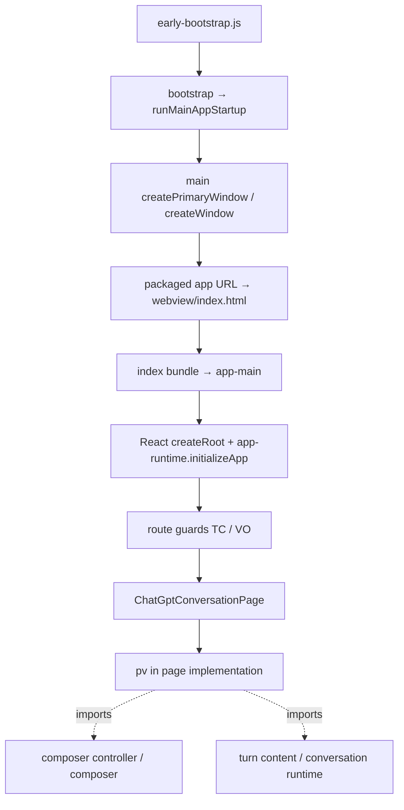

# 官方桌面界面复原：主入口

用户目标：**按步骤推进桌面端官方原生界面**。2026-11-04 起以真正的桌面制品为准，不继续把独立 SwiftUI 或 WebKit 演示壳视为官方界面复原。

最新进展：[启动边界与真实 RPC 隔离回放](STARTUP-BOUNDARIES.md)。17 项路由/preload、8 项原始 RPC、10 项宿主启动、8 项历史转换片段检查通过；已获得首次官方聊天组件截图；完整页面与原生交互仍未验收。

## 当前恢复状态（v43）

清空 localStorage／sessionStorage／IndexedDB 后重新加载页面，旧页面 sentinel 消失且 timeOrigin 改变；同一主进程经 persisted-atom-sync 回传草稿，官方输入框恢复原内容。无 pageErrors。该结果证明页面重建后的宿主同步恢复，尚不证明应用进程重启或磁盘持久化。详见[页面重建回放](../../analysis/desktop-official-20261104/native-draft-document-reload.json)。

## 历史交互状态（v42）

已接入草稿 recordUpdate 的实际写入／删除子集。两条合成会话 A→B→A→B 切换后各自草稿显示正确，主进程也保存两个独立作用域的值。v39–v41 发现 UI 缓存会掩盖主进程写入失败，现已将主进程值加入验收；修复了 IPC 保留 undefined 可选字段导致的误拒绝。仍未证明 renderer 重建或应用重启恢复；详见[草稿回放](../../analysis/desktop-official-20261104/native-draft-recovery.json)。

## 历史交互状态（v38）

官方 Hide sidebar／Show sidebar 按钮已点击回放，布局状态 true → false → true，草稿内容保留，无 pageErrors／renderErrors。已接通焦点状态查询及四个简单状态字段的内存写入与回执。新增明确断点：草稿使用 chatgpt-conversation-prompt-drafts-v2 的 recordUpdate 合并，本宿主仍拒绝，所以不能称草稿持久化已恢复。下一步核对官方合并函数和验证器，再测试切换恢复。详见[侧栏与状态回放](../../analysis/desktop-official-20261104/native-sidebar-state-replay.json)。

## 历史通信状态（v37）

普通 electronBridge 消息也已通过 contextBridge → ipcRenderer.invoke → 主进程处理，状态同步、ready、初始化通知和导航经 IPC 返回页面。v35/v36 暴露通知早于订阅的时序缺陷；v37 改为 ready 后发送离线初始化通知，页面及草稿复验通过。尚未实现状态写入、焦点和窗口模式等消息；详见[消息桥回放](../../analysis/desktop-official-20261104/native-message-bridge-replay.json)。

## 历史通信状态（v34）

官方 renderer 的 connect-app-host 端口已通过最小 preload 适配器交给主进程，再交给独立隐藏 renderer 的模拟服务。聊天内容、草稿输入与窗口缩放／最小化恢复复验通过。这里恢复的是跨进程传递边界，不是官方主进程服务；普通 electronBridge 消息仍在页面内模拟。详见[跨进程 RPC 证据](../../analysis/desktop-official-20261104/native-isolated-rpc.json)。

## 当前验收状态（v31，优先于下方历史进度）

官方完整 renderer 已在独立 Electron 45.1.0 可见窗口中显示合成聊天内容。已检查原生窗口截图；程序调用窗口 API 的 960×640、1440×900 缩放及最小化／恢复均保留草稿，输入框保持在可视范围内。未点击发送，未访问真实服务。

证据：[可见窗口](../../analysis/desktop-official-20261104/native-visible-window.json)、[窗口状态回放](../../analysis/desktop-official-20261104/native-window-lifecycle.json)。运行仍为 partial：使用通用 Electron，尚未恢复真实 preload/main 通道，未验证交通灯点击、窗口拖动、退出恢复或官方同版视觉一致性。下方旧里程碑保留为历史；其中“未执行”不覆盖本节的新证据。

## 本轮已经确定的事实

归档 `packages/ChatGPT-4.0.21.dmg` 中的应用显示名确实为 **ChatGPT**，但内部身份为：

| 项目 | 归档实测 |
|---|---|
| Bundle ID | `com.openai.codex` |
| 官方桌面基线版本 / build | **26.1021.31345 / 21828** |
| ASAR package | `openai-codex-electron` / productName `Codex` |
| 签名标识 | Developer ID Application: OpenAI OpCo, LLC (`2DC432GLL2`) |
| 签名检查 | `codesign --verify --deep --strict` 返回 0；未查询线上撤销状态 |
| DMG SHA-256 | `bb7f21330af3ef7d3f814cb12b2b969683aa2ccbdab7c1239db3adc23db94bdb` |
| app.asar SHA-256 | `130145706a912db74e4d260ad7538f10f1e05e88af955f9afba42cdf01e64606` |

**4.0.21 只是旧归档文件名标签，不能再用作该桌面制品版本。** 不改名、不覆盖原包和旧报告快照。

当前 `/Applications/ChatGPT.app` 的本次只读 metadata 为 `26.1029.61003 / 24614`，同为 `com.openai.codex`，属于另外一个版本，不混入冻结的归档基线。其更新状态可能变化；本轮不读取它的账户/配置/会话数据。

现有解包目录 `recovered/macos/asar-extracted` 的 `package.json`、`.vite/build/` 和 `webview/` 共 **20,957 个成员**已与归档 ASAR 逐文件计算 SHA-256，全部相同。该证据关闭了“旧桌面解包目录与归档安装包对应关系未证明”的断点，但不证明 UI 或行为等价。

## 技术路线纠正

这个基线有实际的 Electron API、桌面 preload/native bridge、React root、打包 JS/CSS，以及 `Codex Framework.framework`。官方页面不是先前新写 SwiftUI 界面的来源。

后续“原生完整复原”以**官方实际桌面组件、布局、资源、桌面宿主和交互行为**为目标。不能因为要求原生效果，就自行把官方 renderer 改写为 SwiftUI；也不能用另一套浏览器演示页冒充其实际效果。具体框架内部原生扩展仍需独立核对。

前两版独立展示实验已按用户要求删除，包括工程、构建、截图和运行缓存。后续只沿官方制品的实际组件与宿主推进，不将补写的替代界面作为复原证据。

## 已定位的真实链路

以下是静态证据链，不是运行验收：

关键页面入口不是泛称的 `conversation-view`（该文件包含 Aeon 会话视图），而是：

- 路由 `/c/:conversationId` 和 `/g/:gizmoId/c/:conversationId`。
- `webview/assets/app-runtime-7eafc695f601.js` 的 `ej` lazy component，经 `TC` / `VO` guard 包装。
- `chatgpt-conversation-page-20e0cd7f5f7a.js` 显式导出 `ChatGptConversationPage`。
- 实现来自 `chatgpt-conversation-page-60cdba72de29.js`，`pv as n` 对应上述导出。
- 该实现导入 `use-chatgpt-composer-controller-ac13273315b4.js`、`composer-6ede3b5d5b04.js`、`chatgpt-conversation-turn-content-2b28a90ef308.js`、`chatgpt-conversation-runtime-4cb49aa0d51c.js`。
- composer controller 中存在 `conversationId`、`draftKey`、`initialPrompt` 及 controller 销毁处理；尚未完成调用状态验证。

preload 暴露 `electronBridge`、`codexWindowType`，并含 IPC、MessagePort、文件拖放、worker 通道和 Sentry 注入。**不能直接加载原 preload 或返回空对象来假装宿主已接通。** 离线宿主需要先逐项确定初始化与页面必需的合同，并拒绝未允许的服务操作。

## 七步推进及当前状态

| 步骤 | 当前状态 | 验收门槛 |
|---|---|---|
| 1. 锁定对象和范围 | 产品、版本、包对应已确认；页面全集仍 partial | 页面和状态清单逐项绑定制品，不能只覆盖聊天样例就称完整 |
| 2. 真实效果基线 | 未执行 | 同版官方窗口、页面和交互对照；必须隔离账户与网络，不读取真实聊天 |
| 3. 组件和资源 | 启动与聊天页面入口已定位 | 页面组件、样式、图标、字体及宿主依赖可追溯；其他页面继续编目 |
| 4. 真实渲染栈 | 原始聊天页已在隔离 Edge 显示合成消息、代码、表格和 composer；完整桌面布局未恢复 | 官方页面/组件在隔离环境中显示；缺少的 bridge/provider 精确记录 |
| 5. 页面状态与交互 | 未执行 | 身份、输入、选择、滚动、取消、切换、恢复经过具体用例验收 |
| 6. 离线组装 | 未执行 | 仅服务边界替换为本地 fixture；保留已证明的官方渲染与交互链 |
| 7. 对照验收 | 未执行 | 对步骤 1 全清单逐项比对；无笼统“基本一致”结项 |

研究顺序：启动与侧栏 → 普通 ChatGPT 会话、composer、消息 → 列表/搜索/附件/设置等页面 → 其他桌面功能及窗口状态。范围不因当前只找到聊天页面而收缩；尚未编目的页面必须在步骤 1 保持缺口。

聊天能力、feature RPC 与历史查询的具体边界见 [聊天数据接入](CHAT-DATA-BOUNDARIES.md)。

## 下一最小动作

1. 继续 `app-runtime.initializeApp → pL` 的服务初始化：remoteConnections、executionHosts 和能力查询 provider；TC/VO 的局部分支已回放，不能当作完整账户生命周期。
2. 补齐真实 `electronBridge` 返回形状，特别是 sidebar 的 globalStateEntries/workspace state。4 个同步启动请求、共享对象更新和 MessagePort 边界已完成片段回放。
3. 从官方聊天组件中定位最小可呈现分支及 provider 依赖，沿用它的 JS/CSS/资源准备隔离 fixture；不再补写替代聊天页面。
4. 在启动任何官方程序前完成独立目录、空用户配置、网络拒绝和进程退出策略。当前尚未启动完整官方目标应用；现有“禁止访问真实聊天/线上服务”边界持续有效。

## 证据与复现

- [包身份、签名输出和 20,957 成员对应表](../../analysis/desktop-official-20261104/baseline.json)
- [30 条 UI 链路证据：文件 SHA-256、字节偏移和上下文](../../analysis/desktop-official-20261104/ui-chain.json)
- [REA 三个入口文件的静态分析摘要](../../analysis/desktop-official-20261104/rea-entry-summary.json)

REA parent Evidence：`ev_3225dd40332511ad9a5c229fe65c0bcb91c493caaac9ec0e5e91d30fc9ddd93d`。仅三个选定文件完成语法分析，其余未分析；unknown 记录达到预算上限，不能用其总图声称完整桌面关系恢复。

只读挂载原 DMG 后，可执行 `analysis/tools/desktop_official_baseline.py --app <挂载内应用> --dmg <原DMG> --output <新报告路径>`。报告拒绝覆盖；未执行任何目标 JS。所有本轮产物未提交、未推送、未发布。

最新入口回放：完整官方 renderer 已显示登录界面（`analysis/desktop-official-20261104/root-signin-display.json`），使用未登录合成宿主。登录后主界面与原生窗口仍未验收；详见 CHAT-DATA-BOUNDARIES.md 的 v10 记录。

Full-root milestone: v16 displays the original sidebar and work composer offline. Evidence: `analysis/desktop-official-20261104/main-shell-first-display.json`. This is the Codex work surface; ChatGPT conversation routing, complete local data, native window and interaction acceptance remain open.

Conversation milestone: v22 renders synthetic ChatGPT history inside the complete original root. See `analysis/desktop-official-20261104/full-root-conversation-display.json`. Lockdown/config errors, complete surface data, native desktop host and interaction validation remain unfinished.
