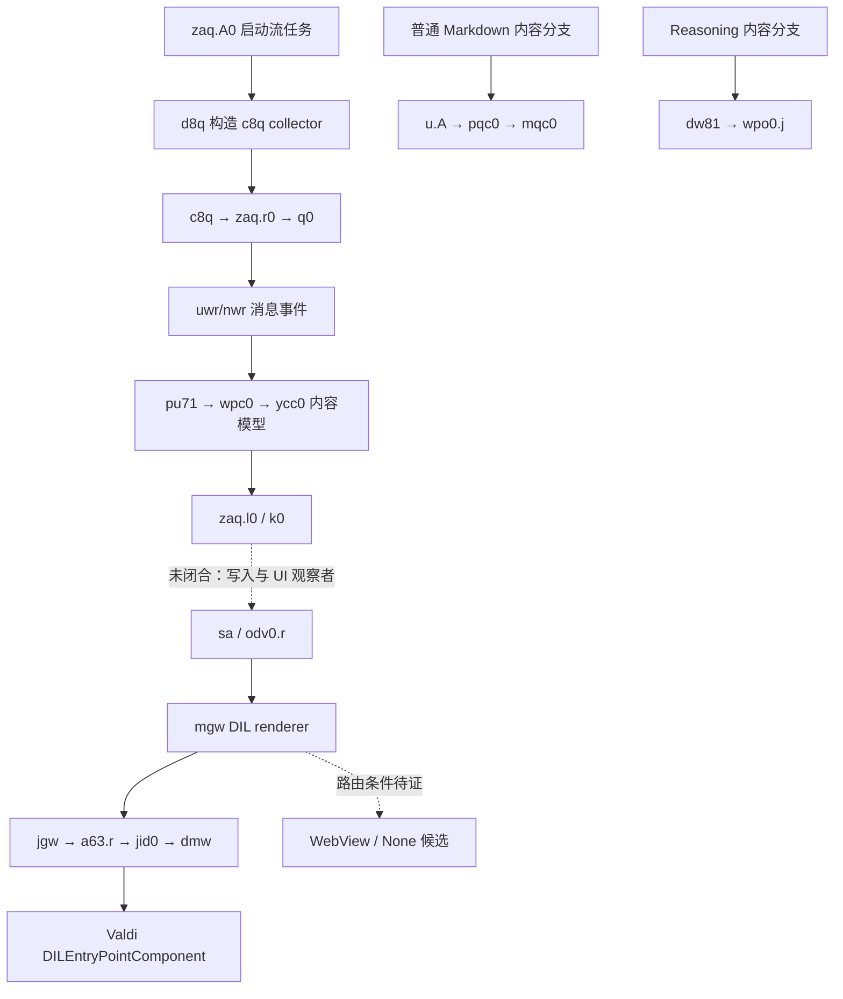

# Android 293：消息投影、身份检查与渲染边界

本报告服务于独立参考架构，不读取或对照其他产品实现。只读当前 `1.2026.293` 官方包提取物，未执行 App 或访问线上服务。整体结论 **partial**；新增 28 个可复核锚点见 [android-evidence.json](../../analysis/reference-architecture-20261103/android-evidence.json)，每条包含文件 SHA-256、行号、字节偏移和限制。`verified` 仅指该静态锚点与摘要成立。

## 1. 这次实际推进了什么

此前未定位的 DIL 宿主上游，现在可追到 `sa → odv0.r → mgw.c/DilRendererImpl → jgw lambda → a63.r → hmw/jid0.c → dmw.b`。关键跳转 `odv0→mgw` 与 `jgw→a63` 已用 smali 核对（A14–A19）。`jgw` 在 JADX 中被内联进 `mgw.java`，只搜独立 Java 文件会遗漏这条边。

消息侧由 `c8q` 收集事件，再调 `zaq.r0 → q0`；消息事件通过 `pu71.i/h → wpc0.h → wpc0.g` 投影为 `ycc0`，然后交给 `l0/k0` 路径。q0 中的投影与 l0 调用已用 smali 核对（A03/A04/A07–A09）。**模型写入到 UI 观察者，再到 sa/odv0 的中间段仍未闭合**，因此不是完整主聊天恢复。

另一个重要纠正是：DIL renderer 的路由枚举明确包含 **Valdi、WebView、None**（A20）。不能把“DIL 内容”直接等同于“Valdi 原生渲染”，也不能从枚举顺序推断线上默认路由。

## 2. 版本化功能链

入口是 `zaq.A0`：取消已有 `U1` job，启动标记为 `ConversationCoordinator/streamConversation` 的 `d8q`，注册 `itb` 完成回调（A01/A02）。这是同一协调器对象的任务管理事实，不能推广为跨会话已正确隔离或所有迟到事件都会丢弃。

数据源到模型：`uwr` serializer 明确包含 `conversationId` 与 `message`；message 类型 `fz3` 的 schema 包含 `id, author, user, content, createTime, status, endTurn, channel, recipient, metadata`（A05/A06）。`pu71.i` 将 `owr.a()` 的消息与 `owr.b()` 的会话标识送入 `wpc0.h`。该映射证明客户端存在内容投影层，不证明服务端所有事件形态、排序保证或幂等策略。

模型后续：q0 构造 `zze(ycc0, String, int, boolean, time)`（A10）。已找到的 `g810` 消费者按关联字符串匹配并计算时间指标（A11），**不能把 zze 直接命名为 UI reducer event**。需要继续定位其余消费者和实际存储观察链。

## 3. 身份与生命周期：哪些可确认，哪些不能命名

| 概念 | 官方静态观察 | 限制 |
|---|---|---|
| conversation | uwr schema 的 conversationId 与消息共同进入投影 | 不等于已证明所有处理入口都先检查会话 |
| message | fz3 schema 的 id，投影目标为 ycc0 | 服务端 ID 分配、乐观 ID 替换和回执关系待查 |
| turn | 存在 endTurn 字段及 turn_trace_id 日志线索 | endTurn 不是 turnId；trace ID 也不能自动当业务轮次 ID |
| request / subscription | 未取得稳定字段全链 | 不将 iOS worker requestId 填进 Android schema |
| 当前状态匹配 | zaq.v0(x) 要求 x 非空且同时等于 w1、u1；Java 与完整小方法 smali 一致（A12） | w1/u1 的全部写入来源未追完，不擅自命名为会话／epoch |
| 旧事件处理 | c8q 在部分分支前调用 v0（A13） | 不是整个 collector 的统一 early-return；不能声称统一丢弃旧事件 |
| 取消 | A0 取消前一 U1 job | 取消完成、子任务清理、持久化和迟到回调行为尚未全部闭合 |
| 完成／错误／重连 | 相关分支位于 c8q/q0/l0/k0 | 大方法有 JADX 错误；本轮只采纳小范围 smali 支撑的调用关系 |

独立设计建议：开发参考合同应分别建模会话、消息、生成轮次、请求与订阅代次；取消产生终止或失效边界，迟到事件先验证归属再更新模型；乐观发送、服务接受、传输确认和生成完成分别结算。这些要求是用于回放的设计建议，**不是已恢复的官方 Android 状态机**。

## 4. 原生／Valdi／WebView 的职责边界

| 层 | 已定位职责 | 仍未回答的问题 |
|---|---|---|
| 消息投影 | fz3＋conversationId → ycc0；wpc0 是具体投影入口 | 完整字段转换、附件和 reasoning 分流、修订与历史合并 |
| DIL 路由 | mgw 的 DilRendererImpl；qgw 路由标签含 Valdi/WebView/None | 选择策略、功能开关、线上生效分支 |
| 原生 Valdi 宿主 | dmw/hnw 创建 nbt；精确模块路径为 DILEntryPointComponent@dil_widgets/src/DILEntryPointComponent（A21/A22） | Android 字节码组件内部行为及版本差异 |
| 增量宿主事件 | ekw 构造 DILHostStateUpdate/JSONPatch（A23） | cmw 的 full-replace/patch/fallback 精确政策，错误重建与恢复 |
| 普通 Markdown | MessageMarkdownContent → pqc0 → mqc0（A24/A25） | 表格、选区、链接、布局与滚动各自最终 owner |
| Reasoning | dw81 的 ReasoningMessageContentImpl → wpo0.j（A26） | 原生流事件到该分支的数据转换，折叠与完成行为 |

`u` 是 R8 合并类，含多种 helper；不能因为其 imports 中存在 Valdi，就把 `u.A` 的 Markdown 分支描述成 Valdi。反之，找到独立 Compose 分支也不能推出“所有正文都走原生”。

键盘/IME composing、输入框、列表稳定 key、主滚动容器、手势仲裁、选区跨块行为、主题字体/图标和平台状态恢复：本轮没有取得足够 Android 调用证据，统一记录为 **unknown**。iOS 明文只能提供后续检索线索，不能替代这些结论。

## 5. 参考验证与性能观察

下列为待执行的参考验证，不是本轮 Android 设备验收结果：

- A→B→A 快切、两会话并行输出、旧订阅迟到事件、取消后完成／错误：记录各层身份与丢弃原因，确认旧作用域不能改写新作用域。
- 重复／乱序历史、非前缀正文修订、临时 ID→服务端 ID、发送回执：比对规范化模型快照，禁止按相同文本合并。
- 原生 Markdown 与 DIL 路由分别覆盖长文本、代码、宽表格、reasoning、附件混合；测试默认路由与明确选定路由，避免将 fallback 当主路径。
- 记录事件接收、排队、投影、状态提交、布局、首帧和滚动修正的分段耗时；区分模型更新频率与设备呈现帧率。g810 的指标消费说明包内存在关联计时，但不构成本设备性能测量。
- 键盘开合、输入法 composing、用户拖动后暂停自动滚动、切换恢复草稿/锚点、前后台恢复须在后续获准的 Android 环境验证；现有 iOS JS 的 16ms 假时钟回放不充当这些结果。

## 6. 精确断点与下一最小取证动作

1. **AG01，模型→UI**：定位 `zaq.l0/k0` 的 ycc0 写入目标与订阅者，向 `sa/odv0` 的输入追溯。先给每条已证边，复杂分支用 smali，不一次性宣称全 reducer 正确。
2. **AG02，身份**：枚举 `zaq.w1/u1` 的写入点，区分导航变化、任务启动、恢复和结束；再判断 v0 的保护覆盖范围。
3. **AG03，DIL 路由**：从 mgw/qgw selector 追 route/feature/debug 配置的实际来源，分别核对 Valdi 与 WebView 的生命周期和内容输入。
4. **AG04，原生交互**：从主聊天列表与输入根组件出发，定位滚动、焦点、IME、选区和恢复 owner；不从通用组件能力倒推主页面接线。

本报告已经把两侧断点各向中间推进，但两端之间仍存在未证明的模型观察连接；Android 消息全链保持 partial。
