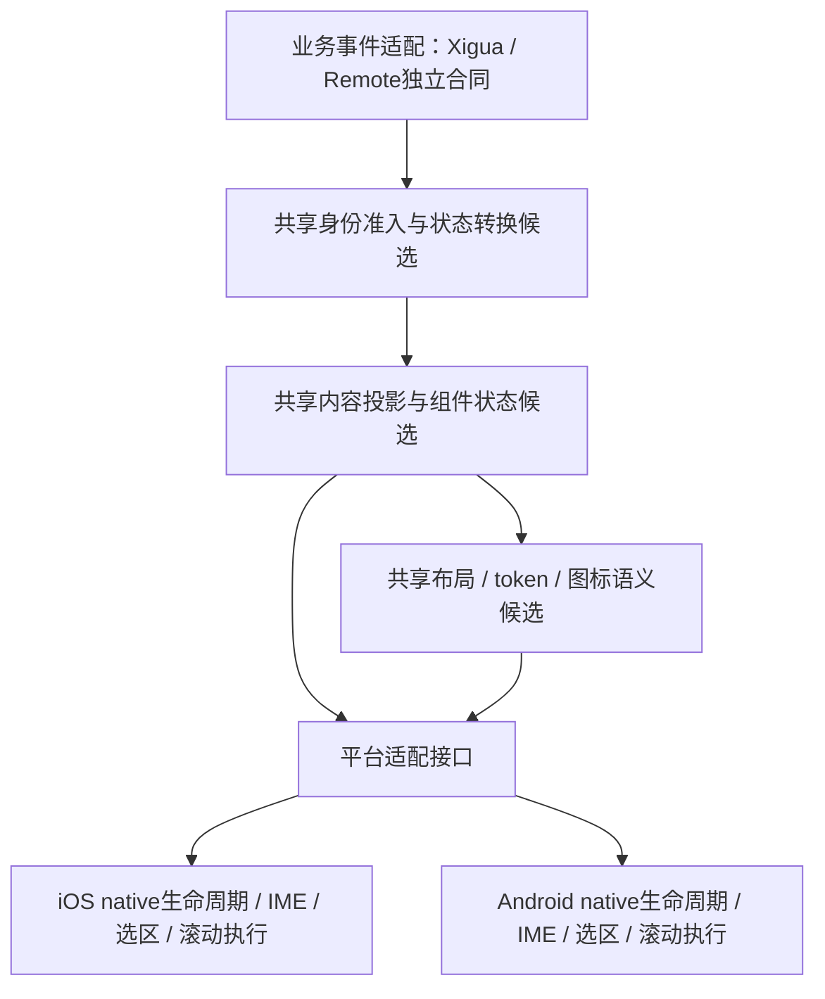

# 移动跨平台参考架构与条件性路线建议

本报告只分析ChatGPT官方制品与公开依赖资料，不读取或评价其他产品代码。Xigua/Remote需求决定问题优先级，不能用来证明官方实现。iOS/Android293分别取证；桌面只在Remote中保留必要连接/RPC线索，桌面UI/Web前端登记待做。

## 1. 实际分层：两端并列，断点不填猜测

| 层 | Android293 | iOS293 | 共享结论与证据缺口 |
|---|---|---|---|
| 传输事件 | zaq/d8q/c8q collector到投影调用已定位 | 包内Worker/Decoder可读；主聊天消费者未知 | 不证明两端主聊天采用同一网络实现；普通聊天与Remote分开 |
| 身份/状态 | uwr.conversationId、fz3.id与内容字段；zaq.v0只保护部分分支 | native message/conversation/turn与presentation字段分别存在；JS requestId隔离可读 | 字段不是完整对应表；epoch/turn/request的跨层映射仍未知 |
| 内容投影 | pu71/wpc0→ycc0→l0/k0 | JS正文/Markdown/DIL投影与native host结构存在 | Android写入→UI观察仍断；iOSnative方法连接仍断 |
| 渲染宿主 | sa/odv0→mgw→a63/jid0/dmw；DIL可选Valdi/WebView/None | native Messages/DILValdi/DILWebView字段、OpenAIXPlat依赖和导入被独立确认 | iOSnative结构比符号名更强，但不能视为方法调用；默认route未知 |
| 组件 | 原生Compose Markdown/reasoning＋关键Valdi字节码 | 明文DIL/Markdown/Component/Renderer | 候选对应不等于Android实现等价，也不证明全屏共享 |
| 平台交互 | 具体composer/IME/scroll恢复owner尚未闭合 | keyboard/focus/scroll/theme JS adapter可读，nativeanchor/composer字段可定位 | 两端主页面调用与行为仍需独立验收 |
| Remote | 293 pool/host generation/RPC操作族已定位 | 原生Remote接线未知 | 不能用普通聊天worker或Androidpool替iOS Remote证明 |

出处：[Android](ANDROID-MESSAGE.md)、[iOS](IOS-PIPELINE.md)、[Remote](REMOTE.md)。每项报告绑定当前源文件摘要和偏移。

## 2. 哪些确实共享，哪些仅相容

此前逐容器比对有6,950个同路径成员，4,672个字节相同：3,476个明文JS候选和1,196个其他资源。另有2,265对Android字节码/iOS明文候选，以及少量其他差异。见 [frontend-crossplatform.json](../../analysis/takeover-20261103/frontend-crossplatform.json)。数字的范围是同路径交集，不是两端全部文件，也不是业务共享率。

关键Component/Renderer/RootComponentsManager/Style/OAITheme/StreamingProtocol在Android为字节码，在iOS为明文；因此不能宣称已证明共享状态或核心算法。即便载荷一致，宿主注入、功能开关、生命周期也可能不同。

Android的DILEntryPointComponent组件路径、viewModel/context及patch事件，与iOS包内JS参数契合；这是**契约对应**。iOSnative则独立证明了Valdi依赖、DILValdiViewModel等字段归属；仍未证明其实际构造参数和事件派发顺序。

## 3. DIL、Valdi与原生适配的职责

- **DIL**：在所检实现中描述/编译内容树、应用patch、通过element/widget registry选择组件。不是网络协议、账号安全或会话状态机的替代。
- **Valdi**：包内有组件生命周期、状态渲染调度、样式及runtime边界；Android原生宿主已定位。不能推导整个ChatGPT都是Valdi。
- **原生宿主**：网络能力、视图、选择菜单、键盘/手势/滚动执行、应用生命周期等桥接入口；业务状态是否由原生持有需逐链证明。
- **会话/连接层**：决定事件归属、请求结算、取消、历史和恢复；页面选择不能代替这些身份。此原则属于参考设计，不声称所有官方代码均满足。

建议共享边界：

图为独立参考架构。共享逻辑滚动意图（follow-tail/anchored/user-dragging），不共享未经换算的像素偏移；共享字体角色与图标语义，不假设两端字体度量或系统资源相同。前后台恢复需绑定任务与订阅代次，UI缓存另用消息/presentation身份，不能把component实例当conversation身份。

## 4. 三条可选路线

| 路线 | 能减少什么 | 仍需维护什么 | 进入条件 |
|---|---|---|---|
| 1.共享契约/测试＋双原生UI | 行为定义与验收口径分叉 | 两套状态实现和组件易漂移 | 两端独立实现同一fixture且状态快照一致；公共需求更新可追踪 |
| 2.共享状态/内容逻辑＋双原生UI | 身份准入、历史合并、取消与投影的重复实现 | 原生组件、布局和交互适配 | 逻辑可从平台副作用分离；跨端执行同一规范化事件轨迹；adapter明确 |
| 3.再共享组件/布局＋原生适配 | 组件结构、状态呈现与视觉规格重复 | IME、选区、滚动测量、系统恢复与工具链 | 先过路线2的身份门槛，再用两端设备证明关键交互、性能和接入成本 |

**条件性推荐**：先以路线2的边界作为验证目标，路线1作为最低共同基线；当共享UI能通过相同设备切片且减少维护面时，再进入路线3。它是需求导向的独立建议，不是对任何现有工程的迁移结论，也不是“官方用了所以应采用”。不能宣称换框架会消除串会话问题。

最小验证切片与18项设备规格见 [FRONTEND-VALIDATION](FRONTEND-VALIDATION.md)。纯模型已提供会话/多主机回放；设备、布局和原生行为均未验收。

## 5. 公开依赖与内部实现分开

2026-11-03查阅的[官方Valdi release页面](https://github.com/Snapchat/Valdi/releases/tag/beta-0.1.1)显示beta-0.1.1及Android构建相关修复；本轮没有安装、构建或验证该版本。它不是ChatGPT包内版本的对应证明。

[官方LICENSE](https://github.com/Snapchat/Valdi/blob/main/LICENSE)当前声明MIT。[选型文档](https://github.com/Snapchat/Valdi/blob/main/docs/docs/choosing-valdi.md)描述TypeScript/Bazel、生成native bindings和平台约束，但其缺口章节标注beta-0.0.x，不能不加验证地当作beta-0.1.1现状。公开资料定位与限制见 [public-dependencies.json](../../analysis/reference-architecture-20261103/public-dependencies.json)。

公开Valdi可作为路线3的待测候选；本轮不预设它优于其他框架，不用它的竞品对比表给其他框架下结论。ChatGPT内部DIL/OpenAI服务组件、资源及私有patch不随上游MIT声明自动成为可移植依赖。可直接复用的是本项目独立定义的合同/合成测试思路；内部制品用于理解和取证。

## 6. 跨端一致性的验收门槛

1. **状态**：同一合成轨迹产生等价身份/内容/终态；包括旧订阅、历史乱序、取消迟到、两主机RPC隔离。不得用同文本代替身份。
2. **组件**：同一内容投影得到相同组件语义和状态；native/Valdi/WebView分支分别验证，不能拿fallback截图证明默认路径。
3. **交互**：IME、键盘、拖动、选区和恢复分别在两平台通过；逻辑策略一致，平台执行允许明确差异。
4. **视觉与性能**：固定样例、屏宽、主题、字号，登记字体度量差异；记录解析、布局、帧与滚动分段数据，不使用JS16ms常量作为设备帧率。

尚缺：iOSnative主会话方法链、Android模型→列表观察连接、两端composer/scroll最终owner、iOS Remote调用链和所有实际设备表现。下一取证点已分别列在专项报告，未闭合处保持partial。
