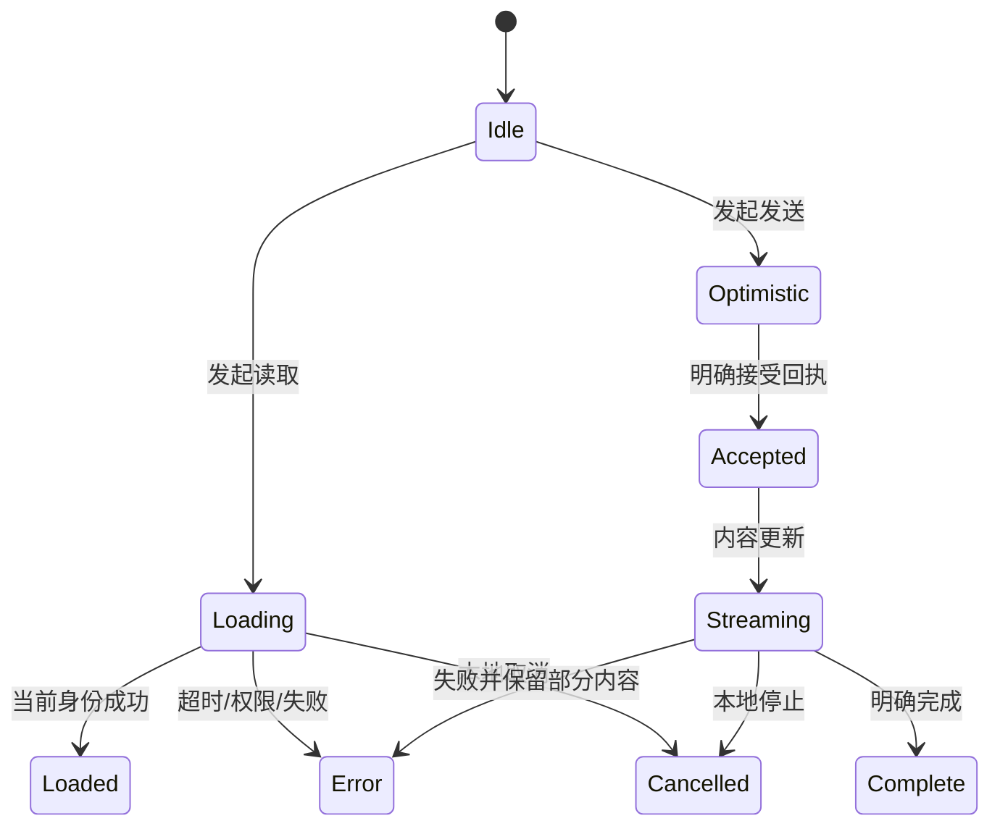

# 两套移动前端的组件职责与验收规格

本文件给 Xigua／Remote 开发提供独立规格，不对照其他产品实现。目标制品为 iOS/Android293；桌面UI与Web前端不在本轮范围。所有视觉、手势、键盘与设备性能场景 **not-executed**，不是本轮通过项。完整18项机器规格见 [frontend-validation.json](../../analysis/reference-architecture-20261103/frontend-validation.json)。

## 1. 组件职责与证据覆盖

| 组件 | Xigua观察 | Remote观察 | 参考职责与缺口 |
|---|---|---|---|
| 根/导航/标题 | Android消息宿主上游已定位；iOS native MessagesViewController字段独立确认 | Android pool选择状态与会话集合分开 | 导航选择不能成为事件路由；两端主页面入口/标题过渡仍待方法级及视觉验证 |
| 会话/设备列表 | 会话模型→主列表观察链尚断 | thread/list封装、Map/active key已定位 | 稳定key与每作用域加载状态；Remote发现聚合与页面消费者未知 |
| 消息内容 | Android原生Markdown/reasoning与DIL多路由；iOS DIL/Markdown明文 | 独立RPC与private-turn等事件通道存在 | 内容投影与UI组件分开；Remote实际消息组件链尚未闭合，不能套用普通聊天正文实现 |
| 输入框 | iOS MessageInputViewModel元数据及通用textfield组件；Android主composer未知 | 发送/interrupt RPC可定位，composer未知 | composing/focus/草稿/发送身份分离；通用输入组件不是主composer证据 |
| 表格/代码/引用 | iOS DIL组件能力可读，Android同路径字节码 | 不能从协议推导组件能力 | 用稳定内容模型驱动块级更新；宽表格、选区和链接两端独立验收 |
| 滚动/选区 | iOS native anchor/cache/height字段和JS adapter；Android最终owner未知 | 页面滚动与导航消费者未知 | 共享滚动意图，平台执行测量/滚动/selection；不能声称实际算法已恢复 |
| 主题/字体/图标 | iOS主题色板及暗色观察器可读；Android候选对应 | Remote移动UI主题覆盖未闭合 | 共享token/角色/资源身份；平台字体度量与辅助字号分别验证 |
| 后台/恢复 | 普通聊天保活Service与iOS draft/lifecycle字段 | 独立Remote前台Service、host_id及通知/气泡代码 | 页面、任务、连接三种生命周期分别管理，Service存在不证明连接持续可用 |
| Goal/审批/目录 | 不混入普通聊天合同 | 操作族可见，owner/权限/消费者未全闭合 | UI存在、协议支持、owner能力、授权、成功五层分开表达 |

具体事实与锚点分别见 [ANDROID-MESSAGE](ANDROID-MESSAGE.md)、[IOS-PIPELINE](IOS-PIPELINE.md)、[REMOTE](REMOTE.md)。表中“参考职责”为建议，不回填成官方实现事实。

## 2. 状态—呈现合同（独立建议）

| 状态 | 用户可见内容 | 动作及终态 |
|---|---|---|
| idle/empty-success | 明确空状态 | 可发起操作，不显示假错误 |
| loading | 指明正在加载的会话/host/资源 | 超时、取消、错误、成功均能结束等待 |
| optimistic/accepted | 保留稳定消息身份，区别已发起与已接受 | 重试使用幂等身份，不能按相同文本猜回执 |
| streaming | 增量内容与可取消状态 | 切换展示不改变归属；可修订正文 |
| complete | 最终内容与已完成状态 | 不接受迟到流继续追加 |
| error | 保留已取得内容和明确错误类型 | 重试/恢复目标明确；权限错误不变空列表 |
| cancelled | 展示本地已停止等待或取消状态 | 不据此声称服务器已停止；迟到结果隔离 |
| capability-unavailable | 解释Goal/新建/审批等不可用的具体层次 | 不把按钮存在当作owner允许 |

该图是简化参考，不限定官方所有状态或事件顺序。解析/渲染调度不能自行把消息变为complete，transport Ack也不代表生成完成。

## 3. 核心场景与产物

- **身份与切换（UI02/13/14）**：共同合成事件，分别采集两端状态快照；先比模型，再比呈现。错误事件必须有丢弃原因，不只截图看起来正常。
- **内容与交互（UI03–06/18）**：长文本、代码、宽表格、reasoning、附件；明确实际renderer路径。DIL不等同Valdi，链接handler存在性与点击行为分开验收。
- **输入/滚动/恢复（UI07–11）**：IME composing、键盘inset、焦点、用户拖动、历史prepend、草稿和锚点恢复。滚动意图建议为follow-tail/anchored/user-dragging三态；平台adapter负责测量与执行，不把两端像素偏移直接互换。
- **主题与视觉（UI12/16）**：固定字号、主题、语言、屏宽及内容；保留Android/iOS各自基准。比较结构、层级、关键几何位置和交互状态，平台差异须列原因。标题背景和过渡只有静态资源时保持unknown。
- **Remote能力（UI15）**：Goal/new/审批各自覆盖支持、不支持、授权拒绝和过期。不得通过客户端隐藏错误模拟服务能力。

默认最小切片：两会话、两主机、一个输入框、长混合消息列表；先在纯模型验证身份和状态，再在获准环境验证每端平台交互。此处没有搭新App或迁移工程。

## 4. 更新/批处理与性能观察

建议每个内容更新记录：作用域与revision、event_received、queue_enter/leave、state_committed、parse_started/finished、layout_submitted、frame_presented、scroll_adjusted。不同进程/设备时钟不能直接相减；先建立时钟来源和关联id。指标不记录真实正文、token或凭据。

将队列等待、内容解析、原生布局、实际帧和滚动修正分别报告。批处理可以合并可覆盖的内容投影，不能丢失accepted/complete/error/cancel等控制事件；先测更新规模、可见行和解析重复率，再确定策略。此项为建议，未模拟设备backpressure。

验收记录P50/P95、最大积压、峰值内存、掉帧与交互中断；本轮不拍脑袋设统一性能阈值。后续选定设备/屏幕刷新率/数据规模后先冻结阈值，再比较路线。包内16ms定时器和0.3s/0.2s键盘配置仅是静态参数，不是设备测量。
