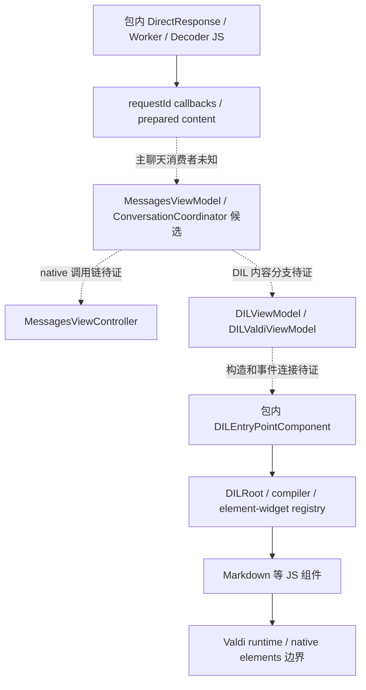

# iOS 293 独立管线与跨平台边界

后续原生接线证据见 [v62](../full-platform/IOS-NATIVE-MARKDOWN.md)：MessageRow 的助手内容 body 类型明确包含 OAIMarkdown.MarkdownBlockStack。下文早期字段／JS 观察保留为历史基础；不能以 JS Markdown 回放替代该原生路径验收。

本报告用于 Xigua／Remote 参考架构研究，范围仅为 ChatGPT iOS 1.2026.293 官方制品的本地提取物。没有读取 Soul、运行 App、调用线上服务或执行原生桥接。Android 结论不用于补齐 iOS 缺口。

证据：[ios-evidence.json](../../analysis/reference-architecture-20261103/ios-evidence.json)。记录包含版本、文件 SHA-256、原始 Mach-O 偏移或 JS 字节偏移、观察类型、限制与状态。I 编号为本轮直接读取的 native metadata；J 编号为包内 JS。所有链路仍为 partial。

## 1. 本轮增加了什么可靠证据

主框架 `recovered/ios-1.2026.293/Payload/ChatGPT.app/Frameworks/ChatGPT.framework/ChatGPT`：192,662,944 字节，SHA-256 `12c03ceded0ce669421b6a9a4e4799104a4a82e491a425652df1aa92a116a6c9`。

**观察：不是仅有几个 Valdi 类名。** Mach-O 的 `LC_LOAD_DYLIB` 明确依赖 `@rpath/OpenAIXPlat.framework/OpenAIXPlat`（I01）；未定义符号表有 32 个 Valdi 相关导入，library ordinal 均为对应的 OpenAIXPlat 依赖，包括 `SCValdiRootView`、`SCValdiRuntime`、`SCValdiScrollView`、`SCValdiTextSelectionGroup`、`SCValdiMarshallerCreate/Destroy`（I02）。这证明 native 链接依赖及导入边界，不证明某一聊天页面实际调用它们。

本轮还直接从 `__swift5_types` 相对类型描述符定位字段描述符，按 Mach-O segment 完成 VM 地址到文件偏移转换，不仅引用旧符号文本：

| Native 类型 | 类型描述符文件偏移 | 直接观察的字段示例 | 不能据此推导 |
|---|---:|---|---|
| `ChatGPTMessages.MessagesViewController`（I03） | 157392868 | `valdiComponentCache`、`conversationState`、`streamingHeightRetention`、`pendingChangedMessageIDs`、`initialMessageAnchor`、`conversationFramePerformanceTracker` | 主列表全部使用 Valdi、实际滚动或批处理算法 |
| `ChatGPTMessages.MessagesViewModel`（I04） | 157393512 | `conversationCoordinator`、`messageInputViewModel`、`_messagesData`、`_anchor`、`_coordinatorIsStreaming` | 稳定会话身份、事件更新顺序或旧事件丢弃正确 |
| `ChatGPTDIL.DILViewModel`（I05） | 157697672 | `retainedValdiViewModel`、`renderingModeSelection`、`allowsWebViewFallback`、`remoteConversationID`、`widgetMessageID`、`turnOrdinal` | 选择 Valdi/WebView 的实际条件及每个界面的默认路线 |
| `ChatGPTDIL.DILValdiViewModel`（I06） | 157698612 | `_componentReference`、`eventDispatcher`、`platformServices`、`_messageIsStreaming`、`shouldSendJSONPatches`、菜单处理字段 | native → JS 的具体构造调用、patch 顺序、设备表现 |
| `ChatGPTDIL.DILWebViewModel`（I07） | 157698828 | `widgetInstanceGeneration`、`widgetInstanceIdentity`、`isRetired`、`lastAppliedStateHash` | 这些字段是否充分隔离旧事件，WebView 是否实际用于主正文 |
| `DILValdiViewModel.CacheKey`（I08） | 157699640 | `messageID/referenceIndex/presentationSurface/presentationInstanceID` | 缓存生命周期或会话间隔离保证 |
| `ChatGPTMessageInput.MessageInputViewModel`（I09） | 157743496 | `accountID`、`conversationCoordinator`、`draftRestorationTask`、`draftWriteTask`、`composerLifecycleIDs`、`mountedComposerIDs` | 输入法组合、发送结算、草稿恢复的具体状态转换 |

字段归属属于静态结构事实；“职责很可能分布在这些 native host/viewModel 中”是可用于下一轮定位的推断，尚不是方法级调用链。

## 2. 当前能画出的 iOS 管线

实线表示已读 JS 内部关系；虚线表示尚未闭合的连接。主框架导入 Valdi 与拥有 DIL 字段都不能把虚线升级为已证明调用。native `remoteConversationID/widgetMessageID/turnOrdinal` 与 worker `requestId` 的映射也未建立。

**后端合同边界**：本轮可引用包内流式事件定义与 API adapter，但没有证明主聊天消费者使用这一实现，更未观察服务器。不能以文件中存在 endpoint、resume 或 token 字段宣称线上能力可用。Remote native 管线需由独立 Remote 专项取证，不从本节普通消息流外推。

## 3. 可读 JS 的职责与平台适配点

| 能力 | 包内观察 | native 边界 / 未知 |
|---|---|---|
| 根与生命周期（J01） | `RootComponentsManager.createWithComponentPath` 提供按路径创建入口；此前报告已定位 Renderer、销毁及 viewModel 更新 | iOS 主聊天传入的实际 component path/context 尚未从 native caller 证明 |
| 键盘与前后台（J02/J03） | `Application` 通过 `ApplicationBridge` 观察键盘和应用状态；unsupported 时存在明确 fallback。`WithKeyboardPadding` 观察高度、调整 padding，销毁时取消订阅；动画配置为显示 0.3s/隐藏 0.2s | 不是主聊天键盘实测；未在当前 derived 路径找到 `ApplicationBridge.js`，其 native 提供者和注册点待定位；fallback 不代表实现一定缺失 |
| 输入与焦点（J05/J06） | `TextInputHandler` 可将 focus 延迟到 element 创建；`oai_ui/TextInput` 渲染 `textfield`，支持受控／内部状态、change/submit/focus 回调，敏感输入不保留普通 value 状态 | 通用表单输入，不可认定为主 composer；IME composing、selection、键盘 inset 仍需 native 方法证据 |
| 滚动（J04） | `ScrollViewHandler` 把 offset 写入 element attributes；区分 main-thread 与 JS listener，支持拖动/滚动/区域/内容尺寸通知及解除绑定 | 只是可用机制；没有证明主消息列表的自动滚动、底部阈值、锚点、用户拖动优先级 |
| 主题（J07） | `OAITheme` 配置 runtime 色板、跟随系统暗色观察器并清理订阅 | 主会话是否全部套用该 provider、动态字号、字体 fallback、原生图标映射仍未知 |
| DIL（J08） | JS 根接收宿主事件并向 DILRoot 转交内容；native metadata 有对应内容/状态/handler 字段 | 契约相容是推断；缺少 iOS native 构造→注册→dispatch 方法证据 |
| 流式片段（J09） | WorkerClient 先删除 requestId 再通知 cancel；后到未知 requestId 消息被忽略 | 现有 12 项隔离回放覆盖该 JS 片段，不能作为 Android 或 iOS 主聊天端到端验收 |

J 系列记录附有 Android 同路径文件的实际摘要、格式和 byte-identical 结果。编码不同的核心组件只做候选对应；即便 byte-identical，注入的 native 能力和调用位置也可能不同。

## 4. 对开发参考架构有用的结论

以下是**独立设计建议**，不是恢复出的官方实现：

1. 把会话身份与事件准入放在内容模型之前，页面焦点不能决定消息归属；组件缓存另外使用 message、presentation、generation 等明确作用域。
2. 共享内容模型和组件状态，集中管理 native 键盘、选择、菜单、滚动执行、前后台恢复适配；不要把 native 生命周期分散复制到每个 JS 组件。
3. 分开保存逻辑滚动意图与平台滚动动作。共享“保持锚点／跟随底部／用户正在拖动”等语义，平台负责实际测量及滚动。
4. 主题 token、字体角色、图标语义可以形成共同规格；字体度量、辅助功能字号和 native 事件顺序需要两端独立验证。
5. native 同时保留 Valdi/WebView 候选结构，不意味着多渲染器错误，也不说明框架统一就能消除状态分叉；优先验证模型与 renderer 的单一职责边界。

## 5. 精确阻塞与最小后续动作

| 未知 | 下一最小取证动作 | 行为验收需另外执行 |
|---|---|---|
| native 主会话 → DILValdiViewModel | 从 I06 类型 metadata accessor／构造函数及 `_componentReference` 写入点找调用者，再找 native component path 构造参数 | 同一会话正文确实命中目标宿主 |
| Worker endpoint 消费者 | 从 native bridge module 注册表及 `ChatGPTStreamingWorkerClient` 创建点找 runtime 对象，禁止只按类名连接 | 双会话、取消后迟到事件、重建 endpoint |
| 内容身份和恢复规则 | 分别追 I04 coordinator 消费、I05 message/turn 字段赋值、I09 draft task 取消及恢复条件 | A→B→A、前后台、输入未提交／恢复中切换 |
| 滚动／输入 ownership | 追 I03 `pendingChangedMessageIDs/initialMessageAnchor` 更新、I09 composer mount/unmount 及 J04 native element 绑定 | 宽表格、动态字号、拖动中增量、键盘开合、IME composing |
| 主题与视觉一致性 | 找 native palette/font/icon adapter，按状态建立双端样例 | 真实布局与帧耗时；不将 16ms 或键盘动画常量当实测 |

本轮验收完成的是：原生依赖与字段归属的独立证据、JS 平台适配机制及精确未知列表；没有交付已闭合的 iOS 主聊天调用链。
