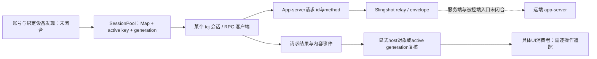

# 官方 Remote 参考架构：293 移动客户端与必要被控端线索

本批次只读 ChatGPT/Codex 官方本地制品，不读 Soul 或 Remodex 实现，不运行 App、请求线上服务或真实聊天。目标是支持连接隔离、请求合同和前端状态职责的开发决策，不宣称恢复完整服务端。

## 基线与证据等级

主证据来自 Android `1.2026.293` 的 JADX 与 smali。iOS 293 的 Remote 原生接线未在本报告闭合，不能从 Android 外推。244 历史协议报告只作搜索线索。

**桌面身份纠正**：现有 `recovered/macos/asar-extracted/package.json` 实际声明 `openai-codex-electron`、`productName=Codex`、`version=26.1021.31345`（R20）。不能把历史“桌面4.0.21”直接贴到当前提取源文件。这里只使用两个文件的精确 SHA；源目录到原始 DMG 的提取来源未重新证明，移动端与该桌面版本兼容性未知。不展开桌面 UI。

全部 Rxx 对应 [remote-evidence.json](../../analysis/reference-architecture-20261103/remote-evidence.json)，包含路径、SHA-256、符号、行号、字节偏移和局限。`partial` 表示静态事实存在但运行/服务链未闭合，不是工具执行失败。

## 1. 已推进的关键事实：连接池不是单一“当前连接”

Android 293 的 `com/openai/feature/codexremote/impl/data/b` 自报 `CodexRemoteAppServerSessionPool`。其快照 `dlj` 包含 generation、active key、会话 Map，`dlj.b()` 用 active key 查 Map（R04）。

- `b.D(key, requireExisting)` 更新 active key 和 generation，保留原 Map；这个小方法内没有断开其他连接（R01）。不能推广为上层切换流程永远不触发断开。
- `b.B(key, expectedSession)` 先检查命名项和对象身份，再移除该项；若被移除者正是 active session，增加 generation（R02）。旧对象的清理不能据此直接删除同 key 的替代对象。
- `b.H(operation)` 优先采用协程中的显式 key，否则采用当前 active session；异步返回后再次检查。显式 key 路径校验 Map 里仍为相同对象；active 路径校验 generation 与 active 对象均未变，否则抛 `ConnectionInvalidated`（R03）。该返回校验已用 `b.smali` 的 generation/object 比较交叉核对（R05）。

这直接支持“选择状态、连接集合、异步操作归属必须分开”的参考设计。**不证明多个主机在设备上均能同时连通、不证明发现列表完整，也不证明所有调用方均传显式 host key。** `b` 的全局 disconnectAll 注册同样存在，必须追清它的触发范围，不能只看局部移除方法。

该图是静态分层与断点图，不是已执行的连接时序。

## 2. 操作合同：官方名称保留，能力与可用性分开

`ijj` 是293请求封装的重要入口；`ohk` 提供独立的 JSON-RPC `jsonrpc/id/method/params` 包装（R15）。这些请求再由连接/RPC层处理，不能把其中 request id 与 Slingshot `seq_id` 或 UI message id 混用。

| 操作 | 293 静态请求/事件 | 已观察的输入或作用域 | 未证明的部分 |
|---|---|---|---|
| 列表 | `thread/list`（R08） | 分配请求 id；有多个查询形态 | 所有主机聚合、账号可见性、加载结束UI |
| 元数据/恢复 | `thread/read`、`thread/resume` | thread scope；resume结果检查分页cursor组合 | 完整恢复状态机、旧响应如何进入页面 |
| 历史 | `thread/turns/list`、`thread/items/list`（R09） | thread/turn/cursor/limit相关参数类 | 去重/顺序语义、跨页完整性和页面合并 |
| 新线程/发送 | `thread/start`、`turn/start` | 每次请求分配id；turn携带thread scope | owner允许范围、真实服务接受、乐观UI结算 |
| 取消生成 | `turn/interrupt`（R10） | payload构造传thread/turn字符串 | 幂等保证、取消后的最终状态、服务端取消完成 |
| Goal | `thread/goal/get/set/clear`（R11/R24） | thread scope；set参数类型为c5m | UI编辑是否开放、owner权限、服务端版本能力 |
| 审批 | `item/commandExecution/requestApproval`、`item/fileChange/requestApproval`、`item/permissions/requestApproval`（R13/R25） | RPC入口识别这些请求并分派 | 具体审批UI、审批关联身份、结果发送和服务端执行门 |
| 目录 | 桌面适配器转发 `fs/readDirectory`（R22） | 参数由调用者传入 | Android目录选择入口、远端handler、路径权限；不能把桌面方法存在当作手机已接通 |

Goal代码存在“app-server lacks thread goals; opening thread without goal state”回退（R12）；部分catch分支有反编译疑点，因此只采纳能力可能缺失及回退路径存在，不声称精确错误匹配完整可靠。新建和Goal均应在参考架构中独立表达“组件存在、协议认识、连接能力允许、owner授权、调用成功”五个层次。

## 3. RPC、传输与权限边界

`dgj` 为293 `CodexRemoteAppServerRpcClient`，每实例持有 response、process exit、private turn通道及请求相关集合（R06）。输入响应按解析的请求标识匹配；无匹配有明确日志路径（R07）。传输失败会注入不同等待通道。复杂dispatch方法含JADX警告，当前未把全部分支视为正确还原。

293信封为 `rxl/pxl`，字段包括 `type, clientId, env_id, streamId, seq_id, skipHistory, cursor, message, segmentId, segmentCount, messageSizeBytes, messageChunkBase64, state, status`（R14）。293存在 `zzl`，日志名是 `CodexRemoteSlingshotRelay`，含连接集合和同步结构（R16）。**历史244的fhd/nlb类、计时器用途、分段及重连参数不能直接套用**。同字段不证明两版传输状态机相同。

注册/凭据层移到当前 `com/openai/feature/codexremote/impl/data/d`：token结果检查本地enrollment身份、非空token、有效期和scopes（R17）。挑战方法可见目标origin/path及身份等比较，但方法标注反编译不正确，完整签名/异常传播仍待smali核验（R18）。这些客户端检查不能证明服务端执行“账号只访问自有绑定设备”；该安全边界必须作为参考合同独立要求。

### 必要桌面线索：只能证明客户端/适配器行为

所选 `src-Dl21kCYQ.js` 的 `am` 请求辅助器按内部请求id注册handler，拒绝重复id，维护timeout、取消和settlement；另有请求队列、inFlight map、可合并读取请求及过期逻辑（R21/R23）。这可支持“连接局部请求表、读取合并与关键操作分优先级”的参考设计，但不是服务端调度证明。

`readDirectory` 在同文件里转发到 `sendAppServerRequest('fs/readDirectory', params)`（R22）。尚未证明这是手机Remote入口最终采用的适配器，也未定位该路径的服务端授权处理；不得扩写为端到端目录已闭合。没有用桌面UI代码支持任何移动布局结论。

## 4. Remote 前端与后台服务的职责界线

Android293有 `com/openai/feature/codex/CodexRemoteSessionForegroundService`：通知/气泡相关处理、`host_id` intent输入可见（R19）。这与普通聊天的 `ConversationStreamingService` 是不同类。前台Service、悬浮UI与传输连接所有者不能因为名字相近合并；Service存在不证明连接持续可用。

| 前端状态/组件 | 可支持的职责划分 | 当前证据缺口 |
|---|---|---|
| 设备选择 | 显示active selection；后台保留session map是独立职责 | 发现/绑定到全部设备列表的数据链，实际切换副作用 |
| 任务列表/历史 | 独立的list/read/resume/分页请求及终态 | 原生页面是否使用这些具体调用、空/错误/加载投影 |
| 输入/发送/取消 | start/interrupt操作与连接销毁分开 | 输入法、焦点、草稿、发送来源标识和按钮状态 |
| Goal/新建 | 能力检查与owner授权独立于UI存在 | 具体编辑组件与服务合同允许范围 |
| 审批/权限 | 识别远端请求后展示作用域与等待状态 | 审批请求到UI再到回执的完整身份链 |
| 标题/过渡/滚动 | 只列验证规格，不给静态代码无从证明的动效结论 | Android/iOS各自的布局与设备行为 |

iOS293 Remote原生链本轮未闭合；旧iOS279资源、符号名字和Android行为均不能替代。两端前端不能先假设同实现。

## 5. 可实施的参考合同与故障定位（独立设计建议）

以下是本项目建议，不是官方wire schema：将账号范围、host key、connection epoch、thread id、request id分开；选中设备仅影响视图，不成为所有后台回调的默认路由。清理必须携带预期连接身份；完成异步操作前复核身份/epoch。请求超时、授权失败、主机离线、列表为空分别建模。不要把Slingshot Ack当成线程建立或生成完成。

离线双主机夹具应满足：A/B请求编号相同也不串回执；A→B切换后A仍按原身份处理；A旧连接清理不删除A新连接；A掉线不让B列表永久loading；未知响应丢弃并记录；权限拒绝保留error而不是空列表；等待超时和晚到响应只结算一次。参考模型的通过不能提升为官方Android已通过。

建议按这些段落定位故障：发现/绑定 → 建连/认证 → RPC发送 → 响应关联 → 历史合并 → UI终态。每层记录身份、开始/结束时间、结果类型；不记录真实聊天正文或凭据。读取耗时需区分队列等待、传输、被控端执行、内容解码及UI呈现，不能归为一个“Remote慢”。

## 6. 精确剩余断点与下一最小动作

| ID | 未闭合边界 | 下一最小取证 |
|---|---|---|
| RU01 | paired-host发现/列表聚合 → SessionPool Map插入 | 查b相关session构造和插入调用；核对active key与全部host list是否独立 |
| RU02 | Android目录入口 → 具体RPC/适配器 | 从目录选择用例的consumer逆向定位，确认是否为fs/readDirectory或另一服务 |
| RU03 | iOS293原生Remote连接/状态/UI | 用iOS本身的调用体证明，不以符号存在或共享模块名闭合 |
| RU04 | 桌面连接适配器 → Remote入口/服务owner授权 | 定向追接收器注册与权限gate，确认客户端代码与被控端handler的关系 |
| RU05 | 293relay重连/Ack/分段状态机 | 对zzl/rxl/pxl的小方法和smali做版本绑定，不继承244参数 |
| RU06 | 请求封装 → 具体移动组件交互 | 针对list/Goal/审批分别追消费者，补状态—呈现矩阵而非假定按钮可用 |

本批次已把多主机会话池、RPC操作族、Goal能力边界及后台服务定位到293，并修正必要桌面提取物身份。全Remote端到端通路仍为partial；没有访问线上服务来填补断点。
